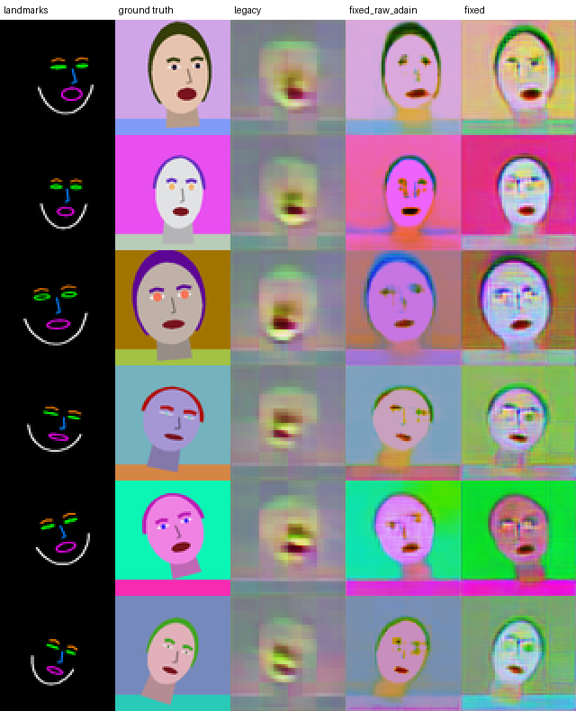

# few-shot-learning-of-talking-heads
Unofficial implementation of "Egor Zakharov et al. Few-Shot Adversarial Learning of Realistic Neural Talking Head Models, 2019" (Keras 3 / TensorFlow).

## Status

The original Keras 2 / TF1 code never trained properly: first it produced black images, then 16 px mosaics (`7.jpg`).
The causes were found and fixed, and the code was ported to Keras 3 (see the PR "Fix AdaIN collapse ..." for the full list):

- images rescaled to [-1, -0.992] by `skimage.transform.resize` without `preserve_range` (black images; fixed in 2019)
- AdaIN scale used as `P e` instead of `1 + P e`, which collapses to ~0 together with the embedding and kills every residual branch
- an AdaIN on the 3-channel output (`Conv -> ReLU -> AdaIN -> tanh`)
- a ReLU applied to the raw input image in the first block of G, E and D
- VGG19 / VGGFace fed [-1, 1] RGB instead of caffe-preprocessed BGR, and the wrong VGG layers
- generator adversarial loss `max(0, 1 - D)` instead of `-D`; matching loss on per-frame embeddings
- no shuffling and a fixed target frame per video

Only a CPU smoke test on synthetic data has been run (below). Training on VoxCeleb2 at 256 px has **not** been verified yet.

## Usage

```bash
pip install -r requirements.txt

# meta-learning; --data contains frames/<id>/<video>/*.jpg and lndmks/<id>/<video>/*.jpg
python meta_learning.py --data datasets/voxceleb2-9f/train --out trained_models

# few-shot fine-tuning on a new person (frames/*.jpg and lndmks/*.jpg)
python fewshot_learning.py --data datasets/fewshot/monalisa --meta-dir trained_models --out trained_models/monalisa

# rendering
python prediction.py --finetuned trained_models/monalisa --landmarks path/to/landmarks/*.jpg --out results
```

With Docker (Python 3.11; runs natively on arm64 and amd64):

```bash
docker build -t fsth .
docker run --rm -v "$PWD":/workspace -v "$HOME/.keras":/root/.keras fsth \
  python meta_learning.py --data datasets/voxceleb2-9f/train --out trained_models
```

VGG19 and VGGFace weights are downloaded from GitHub releases on first use
(or pass `--vgg19-weights` / `--vggface-weights`).
`Config.legacy()` (`--legacy`) reproduces the original behaviour for comparison only.

## CPU smoke test

```bash
python smoke_test.py --arm legacy          --out runs/legacy
python smoke_test.py --arm fixed_raw_adain --out runs/fixed_raw_adain
python smoke_test.py --arm fixed           --out runs/fixed
python make_report.py
```

Procedurally generated heads (`synthetic_data.py`): every identity has its own colours, face shape and hair,
every frame its own pose and expression; the landmark image carries geometry only.
64 px, width 16 (1/4 of the paper), K = 8, batch 6, 3000 steps, ~35 min per run on 2 CPU cores.
Evaluation targets are poses never used for training; "unseen ids" are identities never used for training (no fine-tuning).

Columns: landmarks, ground truth, legacy, fixed but raw AdaIN + old output head, fixed.



| arm | L1 seen ids | L1 unseen ids | 16 px block ratio | output pixel std | AdaIN scale (body / out) |
|---|---|---|---|---|---|
| legacy (original code) | 0.241 | 0.235 | 3.74 | 0.092 | 0.020 / 0.225 |
| fixed, but raw AdaIN + old head | 0.137 | 0.209 | 1.39 | 0.153 | 0.059 / 0.432 |
| fixed | 0.116 | 0.202 | 1.02 | 0.194 | 0.981 / 1.006 |
| *ground truth* | – | – | 1.12 | – | – |
| *baseline: mean of K source frames* | 0.054 | 0.067 | | | |
| *baseline: dataset mean image* | 0.230 | 0.218 | | | |

What this does and does not show:

- The original code is worse than outputting the dataset mean image; its AdaIN scales collapse to ~0.02 and the output is blocky.
- The fixed code does not collapse and follows the landmarks (mouth, tilt, position) and the identity's background/hair colours.
- In this setting most of the improvement comes from the fixes other than the AdaIN parameterisation;
  with the raw parameterisation the scales still collapse (0.06), and fixing it removes the grid and lowers L1 further.
  The contribution of each fix individually was not measured.
- The fixed model is still far worse than the trivial "mean of the source frames" baseline and transfers skin colour poorly:
  this is a check that training now progresses, not a reproduction of the paper.
